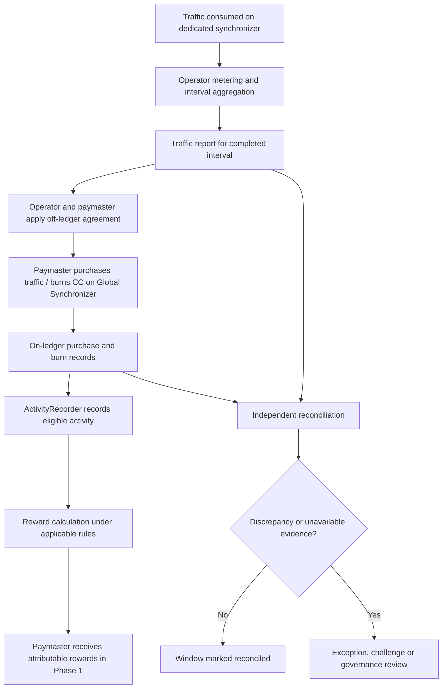

# Dedicated Synchronizer Paymaster: State-Transition Model

**Scope:** CIP-0132 Phase 1 proposal as checked 17 November 2026. This is a research model, not a claim that the full flow is deployed.

## 1. State transitions

The diagram separates five evidence layers:

1. **Consumption:** the underlying traffic events and metering state.
2. **Reporting:** the operator's interval report, including status and completeness.
3. **Commercial settlement:** the off-ledger pricing agreement, discounts and smoothing.
4. **On-ledger payment:** paymaster purchases and CC burns.
5. **Reward accounting:** activity records and resulting reward entitlement.

A public burn record establishes that a burn occurred. It does not, by itself, establish the completeness or correctness of the private consumption measurement, nor prove that the amount satisfies an off-ledger agreement.

## 2. State machine

| State | Entry condition | Evidence retained | Exit condition |
|---|---|---|---|
| Metered | Synchronizer records traffic | Counter snapshot, interval bounds, synchronizer identity | Interval closes |
| Reported | Operator emits interval report | Signed report, sequence number, status, total | Agreement calculation succeeds |
| Priced | Agreement rules applied | Agreement version, price schedule, discount and rounding rules | Payable amount computed |
| Purchased | Paymaster purchase accepted | Purchase identifier, synchronizer, migration, amount and time | Burn confirmed |
| Burned | CC burn is final under applicable ledger semantics | Burn event and transaction/contract reference | Activity record created |
| Activity-recorded | ActivityRecorder accepts eligible activity | Activity record, source reference and rule version | Reward calculation |
| Rewarded | Reward calculation produces entitlement | Calculation inputs, epoch and recipient | Window closed |
| Reconciled | Report, agreement and burn reconcile within tolerance | Reconciliation result and evidence hashes | No open exception |
| Exception | Missing, inconsistent or out-of-tolerance evidence | Exception code and disputed interval | Resolution or governance action |

Unavailable or indeterminate intervals must not be silently treated as zero traffic. They remain a separate state requiring an explicit policy.

## 3. Accounting identities

For interval (t), let:
- (x_t): actual metered consumption, if independently available;
- (r_t): operator-reported consumption;
- (f_v(r_t)): amount payable under agreement version (v), including price, discount, conversion and rounding;
- (b_t): CC actually burned and attributed to the interval or settlement window;
- (a_t): activity recorded for reward purposes;
- (q_t): resulting reward entitlement.

The research model evaluates separate residuals:

[
e^{measurement}_t = r_t-x_t
]

[
e^{settlement}_w = sum_{t in w} f_v(r_t)-sum_{t in w} b_t
]

[
e^{reward}_w = q_w-g(a_w,	ext{reward rules})
]

The first residual is only measurable if an independent consumption reference exists. Public aggregate reports and burn records alone cannot calculate it.

The second residual must be calculated over the contractual settlement window, not necessarily each ten-minute interval. A nonzero interim residual may be legitimate under smoothing or delayed settlement.

The third residual checks implementation against the applicable reward rules. It does not prove that the underlying traffic report was complete.

## 4. Required invariants and non-invariants

### Candidate invariants to test

- Every report has an identifiable synchronizer, interval, schema version and sequence.
- A report status of unavailable/undetermined is not coerced to zero.
- Each burn is counted once in reconciliation.
- The same agreement version and rounding rule are applied throughout a settlement window unless a documented version transition occurs.
- Reward calculations cannot exceed the limits imposed by the applicable on-ledger reward rules.
- Reconciliation is reproducible from preserved inputs.

### Things that are not automatically invariants

- A ten-minute report must equal an immediate ten-minute burn.
- Every public burn can be uniquely attributed to one private traffic interval without a mapping record.
- A Merkle root proves all source events were included.
- A successful paymaster purchase proves the paymaster paid the full contractual amount.
- A recorded activity event proves that the underlying private consumption was accurately measured.

## 5. Open implementation questions

Before applying this model to production data, obtain maintainer or source-level confirmation of:
- report semantics when a participant joins or leaves during an interval;
- interval boundaries and time-zone/clock handling;
- counter reset and logical synchronizer upgrade behaviour;
- whether unavailable intervals are recoverable retrospectively;
- mapping from report windows to paymaster purchases and burns;
- agreement versioning, discounts, rounding and settlement tolerances;
- idempotency and duplicate-purchase handling;
- exact ActivityRecorder inputs and reward epoch attribution;
- dispute and correction procedures.

## 6. Research implication

The first experiment can test agreement-aware settlement reconciliation using synthetic data. It cannot establish real operator accuracy, real underpayment or deployed-system performance. Those claims require authorised linked reports, agreement terms and burn/activity records.
